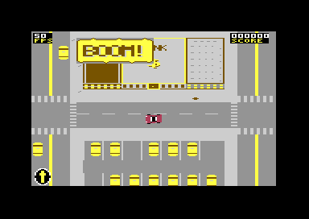
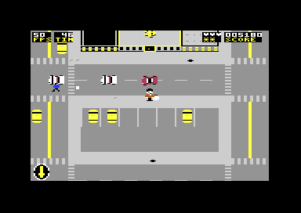
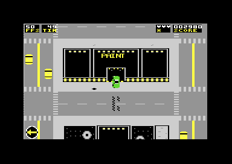
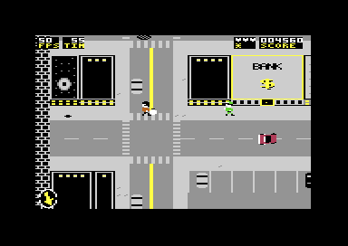

# Boogie Bandit

*New York, 1977. The disco never stops, and neither do you.*

A top-down getaway game for the Commodore 64 (PAL), written in 6502 assembly
for KickAssembler. Drive a 70s sedan through a smooth-scrolling city, park at
the bank the arrow points to, hop out, pull the job (KAPOW! ZOWIE! KACHING!),
and get back to the car before the police arrive (with its own chase tune).
Runs at 50 frames a second,
shown top left. The version (`version.asm`, semantic versioning) is in the
top right corner of the title picture.

 
 
 


## How to play

- Every job has a timer (top, next to the fps). Rob the place before it runs
  out, or that job is off and you lose a heart.
- Each robbery adds a wanted star, and that many police cars come after you.
  A guard runs out of the door after you too (green; at a card shop the
  purple owner). He is a bit slower than you; get to the car, or around a
  block, before he grabs you.
  Lose them all and you get a $500 bonus. If one catches you, you're BUSTED!
- Rob banks and card shops (CARDS sign with a playing card; a smaller take
  of $200-$900). The first target is different each game.
- If one catches you, you're BUSTED!: the police keep your car and the loot
  of the last job, and you go on on foot.
- Steal a parked car: walk up to one and press fire. During a chase, the
  police only notice if one of them is very close; otherwise they lose your
  trail. Stolen cars are back in their spots next game.
- The police get tougher with every bank you rob. The first chase is a single
  slow car. After that, officers stop, get out and shoot (dodge the bullets
  or duck behind a building), and from the third job on they set up
  roadblocks ahead of you. You can just squeeze past one on the sidewalk.
- Three paint garages (look for the yellow PAINT sign; small yellow marks on
  the city map). Stop inside the spray booth during a chase: $300 for a new
  colour (always a different one; it takes a second), and the police lose
  your trail.
- Three hearts, then game over. The best five bandits make the table on the
  title screen.
- Watch out for the yellow cabs.

## Controls (joystick in port 2)

| | |
|---|---|
| Up / down | accelerate / brake and reverse |
| Left / right | steer (on foot: walk) |
| Fire | get out of the car (nearly stopped), get back in (next to it), steal a parked car (next to it) |
| SPACE | city map (fire or SPACE to drive on) |
| M | music on / off |
| D | raster time bar in the border (CPU time of each frame) |

Floor it from a standstill or slide through a corner and you leave rubber on
the road.

## Building

Needs Java, `KickAss.jar` in the parent folder (or `KICKASS_JAR` set) and
VICE (`x64sc`, `c1541` on `PATH`).

```
build.bat run
```

builds `build\boogie.prg`, a disk image `build\boogiebandit.d64` and a tape
image `build\boogiebandit.t64` (the same program, for loaders and emulators
that take .t64), and starts VICE. On a real C64 from the disk:
`LOAD"BOOGIE",8` then `RUN`.

With a Kung Fu Flash cartridge on USB, `build.bat send` builds the game and
sends it straight to the C64, which starts it. The C64 must show the Kung Fu
Flash menu. This uses `ef3usb.exe`, the modified EasyFlash 3 USB tool from the
[Kung Fu Flash repository](https://codeberg.org/KimJorgensen/KungFuFlash/src/branch/master/3rd_party/ef3utils),
looked for in `..\tools\ef3utils` (or set `EF3USB_EXE`). The cartridge's COM
port is found automatically; set `KFF_PORT` (e.g. `COM3`) to choose it.

All graphics, the title picture, the fonts and the music are generated at
build time from the sources; there are no binary assets.

Made in 2026 by Morten.
