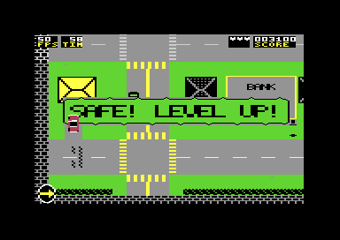
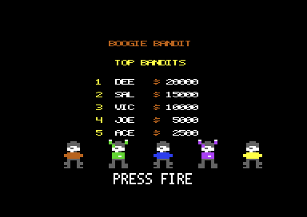

# Boogie Bandit

*New York, 1977. The disco never stops, and neither do you.*

A top-down getaway game for the Commodore 64, written in 6502 assembly. You are
Vinnie "Boogie" Marchetti: drive a 70s sedan through a big smooth-scrolling
New York, pull the job at the bank the
arrow points to (KAPOW! ZOWIE! KACHING!), shake off the police, change cars or
get a new paint job, and bring the loot to your friend's house in the suburb.

**Download:** [boogiebandit.d64](https://github.com/MortenLundberg1977/boogiebandit/releases/latest/download/boogiebandit.d64)
(disk image, `LOAD"BOOGIE",8` then `RUN`),
[boogiebandit.t64](https://github.com/MortenLundberg1977/boogiebandit/releases/latest/download/boogiebandit.t64) (tape image) or
[boogie.prg](https://github.com/MortenLundberg1977/boogiebandit/releases/latest/download/boogie.prg),
the latest version; older ones on the [Releases](https://github.com/MortenLundberg1977/boogiebandit/releases) page.

 
 
 
  

## How to play

- Every job has a timer (top, next to the fps). Rob the place before it runs
  out, or that job is off and you lose a heart.
- Each robbery adds a wanted star, and that many police cars come after you.
  A guard comes out of the door behind you too (green; at a card shop the
  purple owner). After two seconds he runs after you, a bit slower than
  you walk; get to the car, or around a
  block, before he grabs you.
  Lose them all and you get a $500 bonus. If one catches you, you're BUSTED!
- The city is 8 avenues by 16 streets, with 16 banks and 16 card shops to
  rob (CARDS sign with a playing card; a smaller take
  of $200-$900). The first target is different each game.
- The loot only counts once it is at your friend's house, out in the green
  suburb at the south end of town (the yellow roof, bottom left; yellow on the
  city map). Stop in his driveway, but not in the getaway car (steal another
  one or have it repainted first) and not with the police after you: SAFE!
  LEVEL UP! The loot goes
  to your score with a $1,000 x level bonus, and the police start gentle
  again. You can do several jobs before you go there, but the police get
  tougher with each one. When you carry loot in a clean car, the arrow
  turns to your friend's house.
- If one catches you, you're BUSTED!: the police keep your car and all the
  loot you carry, and you go on on foot.
- Steal a parked car: walk up to one and press fire. During a chase, the
  police only notice if one of them is very close; otherwise they lose your
  trail. Stolen cars are back in their spots next game.
- The police get tougher with every bank you rob. The first chase is a single
  slow car. After that, officers stop, get out and shoot (dodge the bullets
  or duck behind a building), and from the third job on they set up
  roadblocks ahead of you. You can just squeeze past one on the sidewalk.
- Six paint garages (look for the yellow PAINT sign; small yellow marks on
  the city map). Stop inside the spray booth: $300 for a new colour, paid
  from the loot you carry (else from your score; always a
  different one; it takes a second). Your car is then no longer the getaway
  car, so you can take the loot to your friend's house in it, and during a
  chase the police lose your trail.
- The arrow (lower left): press A to switch between the next job (yellow
  arrow), your friend's house (green) and the nearest paint garage (pink).
- Three hearts, then game over. The best five bandits make the table on the
  title screen, with the whole gang dancing under it.
- Watch out for the yellow cabs.

## Controls (joystick in port 2)

| | |
|---|---|
| Up / down | accelerate / brake and reverse |
| Left / right | steer (on foot: walk) |
| Fire | get out of the car (nearly stopped), get back in (next to it), steal a parked car (next to it) |
| SPACE | city map (fire or SPACE to drive on) |
| M | music on / off |
| A | the arrow: next job / friend's house / nearest paint garage |
| D | raster time bar in the border (CPU time of each frame) |

Floor it from a standstill or slide through a corner and you leave rubber on
the road.

## Building

Needs Java, `KickAss.jar` in the parent folder (or `KICKASS_JAR` set) and
VICE (`x64sc`, `c1541` on `PATH`).

```
build.bat run
```

builds `build\boogie.prg`, a disk image `build\boogiebandit.d64` and a tape
image `build\boogiebandit.t64` (the same program, for loaders and emulators
that take .t64), and starts VICE. On a real C64 from the disk:
`LOAD"BOOGIE",8` then `RUN`.

With a Kung Fu Flash cartridge on USB, every `build.bat` also sends the game
straight to the C64, which starts it. The C64 must show the Kung Fu Flash menu
(press the cartridge button first: a running game is not stopped); otherwise
the build says "Not sent" after 20 seconds (`KFF_WAIT`) and carries on.
`build.bat nosend` skips sending. This uses `ef3usb.exe`, the modified EasyFlash 3 USB tool from the
[Kung Fu Flash repository](https://codeberg.org/KimJorgensen/KungFuFlash/src/branch/master/3rd_party/ef3utils),
looked for in `..\tools\ef3utils` (or set `EF3USB_EXE`). The cartridge's COM
port is found automatically; set `KFF_PORT` (e.g. `COM3`) to choose it.

All graphics, the title picture, the fonts and the music are generated at
build time from the sources; there are no binary assets.

Made in 2026 by Morten.
