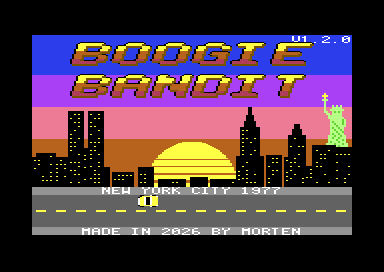
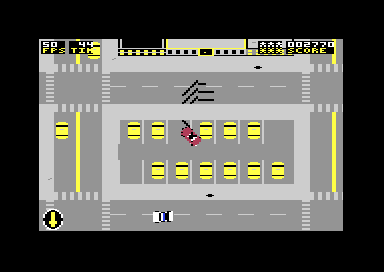
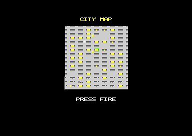

# Boogie Bandit

*New York, 1977. The disco never stops, and neither do you.*

A top-down getaway game for the Commodore 64 (PAL), written in 6502 assembly
for KickAssembler. Drive a 70s sedan through a smooth-scrolling city, park at
the bank the arrow points to, hop out, pull the job (KAPOW! ZOWIE! KACHING!),
and get back to the car before the police arrive. Runs at 50 frames a second,
shown top left.

 
 

## How to play

- Every job has a timer (top, next to the fps). Rob the bank before it runs
  out, or that job is off and you lose a heart.
- Each robbery adds a wanted star, and that many police cars come after you.
  Lose them all and you get a $500 bonus. If one catches you, you're BUSTED!
- Three hearts, then game over. The best five bandits make the table on the
  title screen.
- Watch out for the yellow cabs.

## Controls (joystick in port 2)

| | |
|---|---|
| Up / down | accelerate / brake and reverse |
| Left / right | steer (on foot: walk) |
| Fire | get out of the car (nearly stopped), get back in (next to it) |
| SPACE | city map (fire or SPACE to drive on) |
| M | music on / off |
| D | raster time bar in the border (CPU time of each frame) |

Floor it from a standstill or slide through a corner and you leave rubber on
the road.

## Building

Needs Java, `KickAss.jar` in the parent folder (or `KICKASS_JAR` set) and
VICE (`x64sc`, `c1541` on `PATH`).

```
build.bat run
```

builds `build\boogie.prg`, a disk image `build\boogiebandit.d64` and a tape
image `build\boogiebandit.t64` (the same program, for loaders and emulators
that take .t64), and starts VICE. On a real C64 from the disk:
`LOAD"BOOGIE",8` then `RUN`.

All graphics, the title picture, the fonts and the music are generated at
build time from the sources; there are no binary assets.
